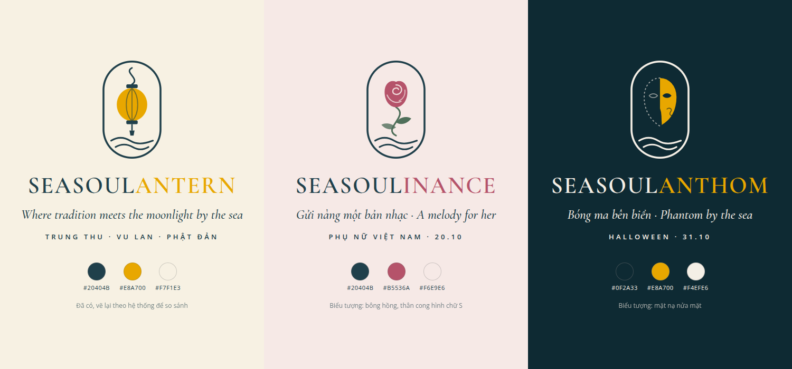
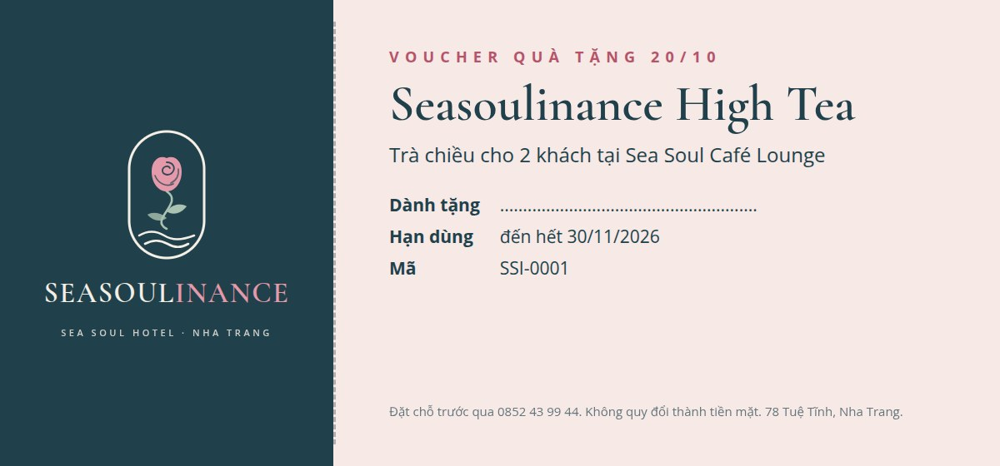
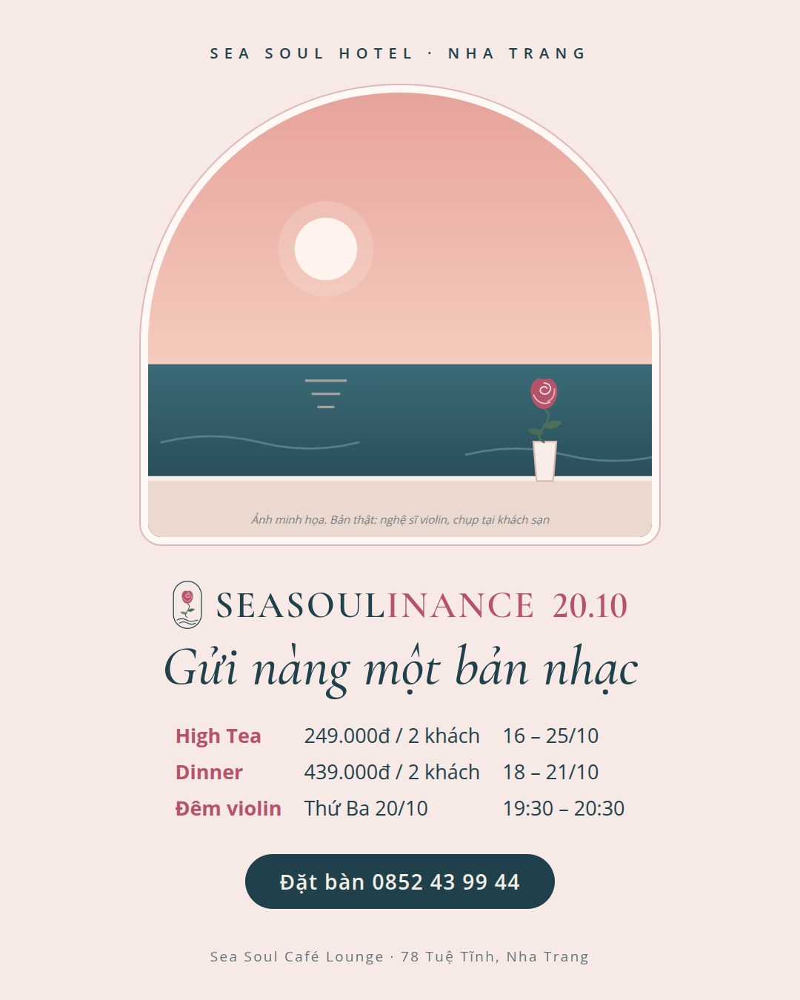
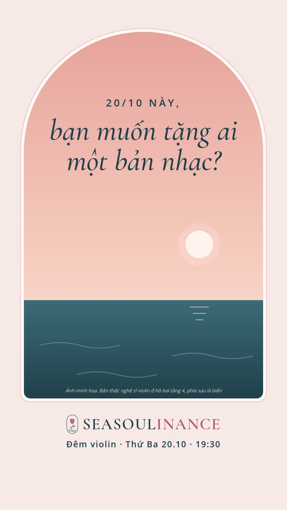
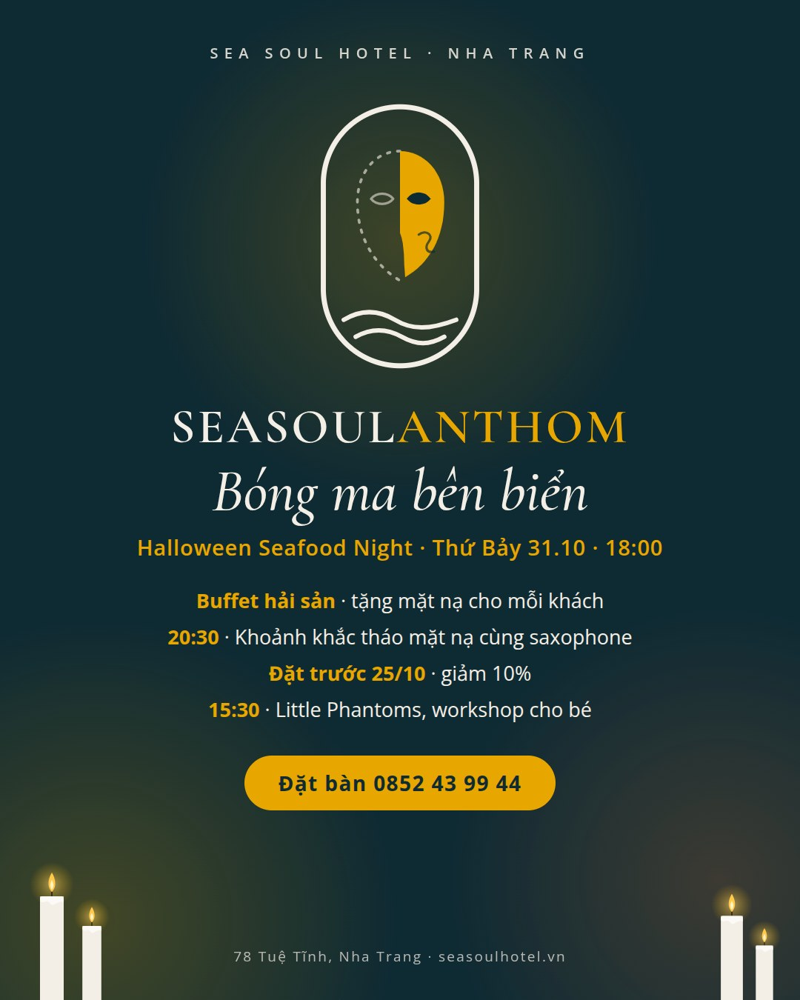
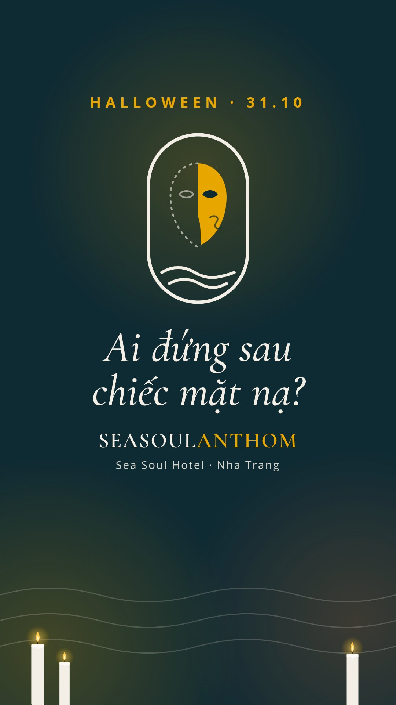

# Đề bài 1: làm 20/10 và Halloween theo kiểu Seasoulantern

> - **Vai trò:** marketing full-stack. Một người lo từ ý tưởng, viết bài, làm hình, chạy quảng cáo tới đo kết quả.
> - **Dữ liệu:** web và Fanpage Sea Soul, cào ngày 12/10/2026 (xem [`tim-hieu/`](../tim-hieu/)). Logo, màu và font lấy từ web Sea Soul.
> - **Thời gian:** hôm nay là thứ Hai 12/10/2026. Còn 8 ngày tới 20/10 (thứ Ba) và 19 ngày tới Halloween 31/10 (thứ Bảy).
> - **Mọi con số về giá, ngân sách và mục tiêu đều là đề xuất**, cần khách sạn duyệt.
> - **Đã điều chỉnh theo 153 bài Fanpage cũ** (13/10/2026): giá ở dòng đầu, đăng buổi tối, thêm mức giá rẻ cho Halloween, thêm điểm cho trẻ em. Lý do ở [`3-bai-hoc-va-dieu-chinh.md`](3-bai-hoc-va-dieu-chinh.md).

## Tóm tắt

| | 20/10 | Halloween |
| --- | --- | --- |
| Tên | **Seasoulinance**, đã báo trên Fanpage ngày 02/10 | **Seasoulanthom**, đã báo trên Fanpage ngày 02/10 |
| Ý tưởng | "Gửi nàng một bản nhạc": khách đề tặng một bản violin cho người phụ nữ của mình | "Bóng ma bên biển": Halloween hóa trang mặt nạ, sang trọng chứ không rùng rợn |
| Nghi thức riêng | Nghệ sĩ chơi bản nhạc và đọc lời đề tặng | 20:30 cả phòng cùng tháo mặt nạ, nâng ly |
| Bán gì | Trà chiều, set tối, đêm violin, spa, voucher cho doanh nghiệp | Buffet hải sản Halloween, workshop cho trẻ em, gói nghỉ cuối tuần |
| Khách chính | Đàn ông muốn tặng quà, nhóm chị em, doanh nghiệp | Gia đình có con nhỏ, khách trẻ, khách du lịch quanh khu phố Tây |
| Tiền mặt (ước tính) | Khoảng 3,5 triệu | Khoảng 10 triệu |
| Đo bằng | Số khách, số lời đề tặng, số voucher bán cho doanh nghiệp | Số khách buffet so với thứ Bảy thường, số bé dự workshop, số gói nghỉ bán được |

## 1. Học từ Seasoulantern và các năm trước

**Giữ lại:**
- **Công thức bài Seasoulantern:** tên chiến dịch, một câu chủ đề, 2–3 trải nghiệm có giờ và giá rõ ràng, số đặt bàn. Đọc xong là biết đi đâu, mấy giờ, hết bao nhiêu tiền.
- **Mức giá cho 2 người khách đã quen:** trà chiều 249k, set tối 439k.
- **Nghi thức riêng.** Seasoulantern có thả đèn hoa đăng. Mỗi chiến dịch nên có một nghi thức như vậy, vì đó là thứ khách nhớ và muốn quay video.
- **Video buffet hải sản.** 3 reels hè 2026 được 33–102 nghìn lượt xem, gấp hàng chục lần các reels khác.

**Sửa:**
- **Báo sớm hơn.** 20/10 năm 2024 chỉ đăng trước 4 ngày, Halloween 2024 trước 8 ngày, Halloween 2025 trên Fanpage chỉ trước 2 ngày, Trung thu 2026 trước 5 ngày. Năm nay đã trễ nên làm bản gọn, nhưng phải công bố ngay trong tuần này.
- **Viết ưu đãi bằng chữ.** Bài 20/10 năm 2024 chỉ có một câu, mọi thông tin nằm trong ảnh.
- **Dùng chữ thường** thay cho chữ kiểu 𝐁𝐎𝐋𝐃, mỗi bài 3–5 hashtag đúng chủ đề.
- **Đăng bài tổng kết trong 48 giờ** sau sự kiện.
- **Đo bằng số khách và doanh thu,** không chỉ đếm lượt thích.

**Các năm trước đã làm gì:**

| Dịp | 2024 | 2025 | 2026 (tới 12/10) |
| --- | --- | --- | --- |
| 20/10 | "Quà đặc biệt" cho khách nữ, chi tiết nằm trong ảnh. Đăng 16/10, 1.583 lượt xem | Web không có bài. Fanpage có bài chúc mừng đăng đúng ngày 20/10 | Fanpage báo đêm violin Seasoulinance |
| Halloween | Giảm phòng tới 31% cộng thêm 10% riêng ngày 31/10; tặng vang khi hóa đơn từ 1 triệu; góc check-in bí ngô. Đăng 23/10, 1.740 lượt xem | Web không có bài. Fanpage làm "Halloween Night Feast – Dạ tiệc ma quái", combo 219k, đăng 29/10 (trước 2 ngày), 44 lượt thích | Fanpage báo Halloween Seafood Night và đêm saxophone Seasoulanthom |

## 2. Logo chiến dịch: một hệ thống dùng cho mọi dịp



**Quy tắc:**
- **Khung:** hình bầu dục giống khung logo chính của Sea Soul, phía dưới có hai đường sóng.
- **Biểu tượng:** mỗi dịp một biểu tượng, luôn có một nét cong hình chữ S, giống thân cây dừa trong logo chính.
- **Chữ:** "SEASOUL" màu xanh thương hiệu #20404B, phần đuôi dùng màu riêng của dịp. Font Cormorant Garamond, là font tiêu đề đang dùng trên web.
- **Dòng phụ:** font Open Sans, là font chữ thường trên web.
- **Lợi ích:** mỗi dịp chỉ đổi biểu tượng và màu, nên làm nhanh và rẻ. Khách nhìn là nhận ra cùng một khách sạn.

| Chiến dịch | Biểu tượng | Màu riêng | Câu chủ đề |
| --- | --- | --- | --- |
| Seasoulantern (đã có) | Đèn lồng | Vàng #E8A700, màu nhấn trên web | Where tradition meets the moonlight by the sea |
| Seasoulinance (20/10) | Bông hồng, thân cong hình chữ S | Hồng đất #B5536A | Gửi nàng một bản nhạc · A melody for her |
| Seasoulanthom (31/10) | Mặt nạ nửa mặt | Vàng #E8A700 trên nền xanh đêm #0F2A33 | Bóng ma bên biển · Phantom by the sea |

**Về hai cái tên:**
- **Seasoulanthom dễ hiểu:** nghe như "phantom" (bóng ma), hợp với Halloween và với đêm saxophone.
- **Seasoulinance khó đọc và khó đoán nghĩa.** Tên đã công bố ngày 02/10 nên năm nay vẫn giữ, nhưng luôn đi kèm câu "Gửi nàng một bản nhạc" để khách hiểu ngay. Năm sau nên ghép với một từ ai cũng nhận ra, như Seasoulantern ghép với "lantern".

Seasoulantern ở đây được vẽ lại theo hệ thống để so sánh. Khách sạn có thể đã có thiết kế riêng cho chiến dịch này.

## 3. 20/10: Seasoulinance, "Gửi nàng một bản nhạc"

### 3.1 Ý tưởng
- **Khách đang tìm gì:**
  - Đàn ông tìm cách cảm ơn mẹ, vợ, người yêu.
  - Doanh nghiệp tìm quà hoặc chỗ tổ chức cho nhân viên nữ.
  - Nhóm chị em tìm một chỗ đẹp để ngồi với nhau.
- **Sea Soul có sẵn gì:**
  - Đêm violin ngày 20/10 đã có trong lịch nhạc.
  - Hồ bơi tầng 4 nhìn ra biển mở lại từ 15/10.
  - Spa đang có ưu đãi mua 1 tặng 1 tắm lá Dao Đỏ (bài Fanpage ngày 29/09).
- **Ý tưởng:** biến đêm violin thành một món quà.
  - Khách chọn 1 trong 12 bản nhạc có sẵn và viết một lời đề tặng.
  - Nghệ sĩ chơi bản nhạc đó và đọc tên người nhận.
  - Người nhận giữ lại tấm thiệp.
- **Vì sao chọn cách này:**
  - Chi phí thấp, chỉ tốn thiệp và hoa.
  - Tạo khoảnh khắc đáng quay video.
  - Khác với kiểu giảm giá thông thường.

### 3.2 Trải nghiệm và giá

| Trải nghiệm | Thời gian | Giá đề xuất | Ghi chú |
| --- | --- | --- | --- |
| Seasoulinance High Tea | 16 – 25/10, 14:00 – 17:00 | 249k cho 2 khách | Giống trà chiều Seasoulantern. Mỗi khách nữ được tặng một bông hồng |
| Seasoulinance Dinner | 18 – 21/10 | 439k cho 2 khách | Set Á hoặc Âu, tráng miệng, 2 đồ uống đặc biệt |
| Đêm violin "Gửi nàng một bản nhạc" | Thứ Ba 20/10, 19:30 – 20:30 | Miễn phí khi gọi món | Nhận lời đề tặng qua inbox, Zalo hoặc tại bàn. Tối đa 12 bản |
| Đồ uống Rose Sonata | 16 – 25/10 | 69k mocktail, 109k cocktail | Hoa dâm bụt, siro hồng, vải. Giống cách làm đồ uống riêng dịp Valentine |
| Spa cùng mẹ, cùng chị em | Theo ưu đãi hiện có | Mua 1 tặng 1 tắm lá Dao Đỏ | Không cần giảm thêm, chỉ gói lại thành quà 20/10 |
| Quà cho khách nữ đang lưu trú | 20/10 | Tặng | Hoa hồng và thiệp, trao lúc nhận phòng hoặc khi dọn phòng buổi tối |

### 3.3 Bán cho doanh nghiệp: làm ngay ngày 13/10
- **Voucher quà tặng:**
  - Voucher trà chiều 249k cho 2 khách và voucher spa, in sẵn trong phong bì có logo Seasoulinance.
  - Mua từ 10 voucher giảm 10%, từ 30 voucher giảm 15%. Bánh Trung thu từng giảm tới 30% cho đơn lớn.
  - Hạn dùng tới 30/11 để kéo khách tới vào mùa thấp điểm.
- **Tiệc trà 20/10 cho công ty:** 15–60 khách, ở Café Lounge hoặc phòng hội nghị, ngày 19–20/10, có một tiết mục violin. Giá đề xuất từ 150k mỗi khách.
- **Gửi cho ai:** công ty đã đặt tất niên 2025, khách hội nghị, khách mua bánh Trung thu số lượng lớn.
- **Cách gửi:** gọi điện trước, sau đó gửi tin Zalo hoặc email theo mẫu ở mục 3.5.
- **Chào luôn tiệc tất niên 2026 đặt sớm** trong cùng cuộc gọi. Trên Fanpage, tiệc và hội nghị là nhóm bài được thích nhiều nhất; tiệc tất niên 2025 được 1.066 lượt thích.



### 3.4 Lịch triển khai

| Ngày | Kênh | Việc |
| --- | --- | --- |
| T3 13/10, 19:30 | Fanpage, Instagram, web, Google Maps | Đăng bài công bố Seasoulinance (mẫu ở 3.5), giá ở dòng đầu. Bài đăng buổi tối được thích nhiều hơn |
| T3 13/10 | Điện thoại, Zalo, email | Gửi chào bán cho doanh nghiệp |
| T4 14/10 | | Buổi chụp chung cho cả hai dịp ở Café Lounge và sảnh (mục 3.6 và 4.6) |
| T5 15/10 | Reels, TikTok | Reel 1: "Bạn muốn tặng ai một bản nhạc?". Bắt đầu chạy quảng cáo |
| T5 15/10, chập tối | | Chụp violin ở hồ bơi tầng 4 nhìn ra biển, đúng ngày hồ bơi mở lại |
| T7 17/10 | Fanpage, Instagram | Bài nhiều ảnh: 4 cách cảm ơn phái đẹp ở Sea Soul |
| T2 19/10 | Fanpage | Bài về nữ nhân viên Sea Soul: ảnh chân dung và một câu của từng người (phải xin phép trước). Cuối bài nhắc ưu đãi, hoặc chuyển thành Story |
| T3 20/10 | Story, livestream ngắn | Hoa, thiệp, các bản đề tặng. Phát thiệp mời Halloween có ưu đãi đặt sớm. Không đăng bài chúc mừng suông: năm 2025 bài này chỉ được 37 lượt thích |
| T4 21 – T5 22/10 | Fanpage, web | Reel tổng kết, bài tổng kết trên web |

### 3.5 Nội dung mẫu

**Bài công bố trên Fanpage và Instagram**

```text
SEASOULINANCE 20.10 – Gửi nàng một bản nhạc 🌹

Tháng 10 này, Sea Soul Café Lounge dành tặng phái đẹp tiếng violin, một tách trà chiều và một bông hồng.

✦ Seasoulinance High Tea – 249.000đ / 2 khách
16 – 25/10, 14:00 – 17:00. Mỗi khách nữ được tặng một bông hồng.

✦ Seasoulinance Dinner – 439.000đ / 2 khách
18 – 21/10. Set Á hoặc Âu, tráng miệng và 2 đồ uống đặc biệt.

✦ Đêm violin "Gửi nàng một bản nhạc"
Tối thứ Ba 20/10, 19:30 – 20:30.
Nhắn cho Sea Soul tên người nhận, lời nhắn và bản nhạc bạn chọn. Nghệ sĩ sẽ chơi và đọc lời nhắn của bạn. Chỉ nhận 12 lời đề tặng.

Đặt bàn: 0852 43 99 44 (gọi hoặc Zalo)
📍 Sea Soul Café Lounge, 78 Tuệ Tĩnh, Nha Trang

A melody for her: afternoon tea, violin nights and a rose for every lady at Sea Soul Café Lounge, 16–25 Oct.

#Seasoulinance #SeaSoulHotel #NhaTrang #20thang10
```

**Tin chào bán cho doanh nghiệp (Zalo hoặc email)**

```text
Chào anh/chị [tên],

Sea Soul Hotel xin gửi anh/chị vài gợi ý quà 20/10 cho chị em trong công ty:

1. Voucher trà chiều Seasoulinance: 249.000đ cho 2 khách, dùng tới 30/11/2026.
2. Voucher spa tắm lá Dao Đỏ.
3. Tiệc trà 20/10 tại Café Lounge cho 15–60 khách, có tiết mục violin.

Đặt từ 10 voucher giảm 10%, từ 30 voucher giảm 15%. Voucher in sẵn trong phong bì và được giao tận nơi trong Nha Trang.

Nếu anh/chị cần báo giá chi tiết, em xin gửi ngay trong ngày.
[Tên] – Sea Soul Hotel – [số điện thoại]
```

**Kịch bản reel 1 (15–20 giây)**

| Giây | Hình | Chữ trên hình |
| --- | --- | --- |
| 0–3 | Cận tay kéo vĩ violin dưới ánh đèn vàng ở Café Lounge | 20/10 này, bạn muốn tặng ai một bản nhạc? |
| 3–8 | Tấm thiệp viết tay "Gửi mẹ…", bông hồng trên bàn trà | |
| 8–13 | Bộ trà chiều, rót trà, hai người phụ nữ trò chuyện | Seasoulinance High Tea · 249k / 2 khách |
| 13–18 | Café Lounge buổi tối, nghệ sĩ đang chơi | Đêm violin · 20.10 · 19:30 |
| Cuối | Logo chiến dịch | Đặt bàn 0852 43 99 44 |

Nhạc nền là bản violin thu ngay tại chỗ, để không vướng bản quyền.

**Bài trên web:** đặt tiêu đề "Quà 20/10 ở Nha Trang: trà chiều, đêm violin và spa tại Sea Soul". Viết đủ giờ, giá và cách đặt bằng chữ. Ảnh có mô tả. Cuối bài có link Zalo.

### 3.6 Hình ảnh

<p> </p>

Cảnh biển trong hai mẫu trên chỉ là hình minh họa, bản thật dùng ảnh chụp tại khách sạn. Nha Trang nhìn ra biển ở phía đông, nên không có cảnh mặt trời lặn trên biển. Lúc chập tối, bầu trời phía biển chuyển hồng và trăng lên, nên mẫu vẽ theo cảnh đó. Ngày 20/10 rơi vào khoảng mùng 10 âm lịch: trăng đã hơn nửa và mọc từ chiều, nên chập tối nhìn thấy trăng trên biển.

**Cần chụp và quay** (dùng nhân viên và nghệ sĩ của khách sạn):
- **Chiều 14/10, ở Café Lounge và sảnh, khoảng 2 giờ:**
  - Cận tay kéo vĩ violin và nghệ sĩ đang chơi.
  - Bộ trà chiều chụp từ trên xuống, có hoa hồng và thiệp viết tay.
  - Nhân viên nữ mặc áo dài ở sảnh, tận dụng cột và vòm kiến trúc tân cổ điển.
  - Phòng tắm lá Dao Đỏ: hơi nước, lá thuốc.
  - Chân dung nữ nhân viên ở các bộ phận, cho bài ngày 19/10.
- **Chập tối 15/10, ở hồ bơi tầng 4, khoảng 17:15 – 17:45:** nghệ sĩ violin, phía sau là biển. Ảnh này dùng cho bài ngày 17/10 và 20/10, và quảng bá luôn hồ bơi mới mở lại.

**Màu và chữ:** nền hồng phấn #F6E9E6, chữ xanh #20404B, điểm nhấn hồng đất #B5536A. Tiêu đề dùng Cormorant Garamond, chữ thường dùng Open Sans.

### 3.7 Đo kết quả

| Chỉ số | Cách đo | Mục tiêu đề xuất |
| --- | --- | --- |
| Số khách trà chiều và set tối | Hóa đơn ghi "Seasoulinance" | Cao hơn tuần 05 – 11/10 |
| Số lời đề tặng | Đếm thiệp | Đủ 12 bản |
| Doanh nghiệp mua voucher hoặc đặt tiệc | Đơn hàng | Ít nhất 3 doanh nghiệp |
| Khách biết chương trình qua đâu | Hỏi khi khách đặt bàn, ghi vào bảng tính | Ghi được cho mọi lượt đặt |
| Lượt xem reel, số tin nhắn | Meta Business Suite | So với các reels thường (470 – 3.400 lượt xem) |

## 4. Halloween: Seasoulanthom, "Bóng ma bên biển"

### 4.1 Ý tưởng
- **Thấy gì:**
  - Năm nay 31/10 rơi vào thứ Bảy, trùng tối có buffet hải sản. Đây là sản phẩm có video mạnh nhất trên Fanpage.
  - Halloween Seafood Night và đêm saxophone Seasoulanthom đã được báo từ 02/10.
  - Khách sạn nằm cạnh khu phố Tây, nơi có nhiều khách nước ngoài.
  - Khách gia đình thích workshop cho trẻ em. Sea Soul đã làm workshop lồng đèn và bánh quy.
  - Góc check-in bí ngô năm 2024 có 1.740 lượt xem, cao hơn phần lớn bài khuyến mãi khác.
  - Halloween 2025 có "Dạ tiệc ma quái" với combo 219k, nhưng chỉ báo trước 2 ngày.
- **Ý tưởng:** làm Halloween sang trọng thay vì rùng rợn, lấy cảm hứng từ "Bóng ma nhà hát": mặt nạ nửa mặt, nến, saxophone, màu xanh đêm và vàng. Cách này hợp với kiến trúc tân cổ điển của khách sạn và với cái tên Seasoulanthom. Trẻ em cũng không sợ.
- **Nghi thức riêng:**
  - Khách được tặng một chiếc mặt nạ ở cửa.
  - 20:30, khi saxophone vào bài cuối, cả phòng cùng tháo mặt nạ và nâng ly.
  - Sau đó bình chọn trang phục đẹp nhất.

### 4.2 Trải nghiệm và giá

| Trải nghiệm | Thời gian | Giá đề xuất | Ghi chú |
| --- | --- | --- | --- |
| Seasoulanthom Seafood Night | Thứ Bảy 31/10, 18:00 – 22:00 | Giá buffet hiện hành theo Fanpage: 435k người lớn, 215k trẻ em. Đặt trước 25/10 giảm 10% | Thêm món theo chủ đề: súp bí đỏ, mì mực đen, tráng miệng hình bóng ma. Mỗi khách một mặt nạ |
| Saxophone và khoảnh khắc tháo mặt nạ | 19:30 – 20:30 | Đi kèm buffet | 20:30 cả phòng tháo mặt nạ, nâng ly |
| Phantom Combo (mức giá thứ hai) | 31/10, 19:00 – 22:00 | Khoảng 219k | Ở Café Lounge: 1 ly Phantom Potion, 1 món nhẹ, mặt nạ, nghe saxophone. Dành cho người trẻ không ăn buffet. Halloween 2025 đã bán combo 219k |
| Đồ uống Phantom Potion | 24/10 – 01/11 | 69k mocktail, 109k cocktail | Trà hoa đậu biếc đổi từ xanh sang tím khi thêm chanh, rất hợp quay video |
| Bình chọn trang phục | 31/10, 20:45 | Giải nhất 1 đêm phòng Premier Sea View, giải nhì buffet cho 2 khách | Mùa thấp điểm còn phòng trống nên chi phí thật thấp. Giải thưởng cũng giới thiệu luôn hạng phòng |
| Workshop Little Phantoms | 31/10, 15:30 – 17:00 | Miễn phí cho bé đang lưu trú, 99k cho bé ở ngoài | Vẽ mặt nạ, trang trí bánh quy, đi săn kẹo qua 4 điểm: lễ tân, Café Lounge, spa, pool bar. Nhận tối đa 20 bé |
| Lái xe tải công trường cho bé | 31/10 | Miễn phí 30 phút cho bé dùng buffet (giá thường 100k mỗi giờ) | Khu này đã có sẵn ở Café Lounge. Video giới thiệu khu này được 556 lượt thích |
| Góc check-in | 24/10 – 01/11 | | Ở sảnh, Café Lounge và hồ bơi vừa mở lại |
| Gói Seasoulanthom Weekend | Đêm 30/10 hoặc 31/10 | Giá phòng đang bán cộng giá buffet. Tặng workshop và trả phòng muộn tới 14:00 | Dành cho gia đình ở Nha Trang, Cam Ranh, Ninh Hòa |

### 4.3 Lịch triển khai

| Ngày | Kênh | Việc |
| --- | --- | --- |
| T4 14/10 | | Quay teaser trong buổi chụp chung |
| T5 15/10 | Reels, TikTok | Teaser: bóng người đeo mặt nạ thổi saxophone dưới ánh nến. Chữ: "31.10 · Ai đứng sau chiếc mặt nạ?" |
| T7 17/10, 19:30 | Fanpage, Instagram, web, Google Maps | Bài công bố đầy đủ, kèm ưu đãi đặt trước 25/10. Báo trước 14 ngày; năm 2025 chỉ báo trước 2 ngày |
| T5 22/10 | Reels | Reel 2: buffet hải sản bản Halloween, làm theo công thức reels buffet hè. Dồn ngân sách quảng cáo vào đây |
| T7 24/10 | Fanpage, Story | Ra mắt góc check-in và Phantom Potion |
| T2 26/10 | Fanpage, Zalo, các nhóm phụ huynh nếu nhóm cho phép | Bài workshop cho bé, nhận đăng ký qua Zalo |
| T4 28/10 | Fanpage, Zalo | Gói Seasoulanthom Weekend |
| T6 30/10 | Story | Nhắc lần cuối. Chỉ báo "còn ít bàn" khi đúng là còn ít |
| T7 31/10 | Story, livestream ngắn | Workshop, buffet, khoảnh khắc tháo mặt nạ |
| CN 01 – T2 02/11 | Fanpage, web | Reel tổng kết, album ảnh, công bố người thắng, bài tổng kết trên web |

### 4.4 Nội dung mẫu

**Bài công bố**

```text
SEASOULANTHOM · HALLOWEEN 31.10 – Bóng ma bên biển 🎭

Tối thứ Bảy 31/10, mời bạn đeo mặt nạ, thưởng thức buffet hải sản và nghe saxophone dưới ánh nến.

✦ Seasoulanthom Seafood Night – 18:00 – 22:00
435.000đ người lớn · 215.000đ trẻ em
Buffet hải sản không giới hạn, thêm các món theo chủ đề Halloween. Mỗi khách được tặng một chiếc mặt nạ.
Đặt trước 25/10: giảm 10%.

✦ 20:30 – Khoảnh khắc tháo mặt nạ
Saxophone vào bài cuối, cả phòng cùng tháo mặt nạ và nâng ly Phantom Potion.

✦ Bình chọn trang phục đẹp nhất – 20:45
Giải nhất: 1 đêm phòng Premier Sea View.

✦ Phantom Combo – khoảng 219.000đ, từ 19:00
Một ly Phantom Potion, một món nhẹ, mặt nạ và đêm saxophone ở Café Lounge.

✦ Little Phantoms – workshop cho bé, 15:30 – 17:00
Vẽ mặt nạ, trang trí bánh quy, đi săn kẹo quanh khách sạn. Nhận 20 bé, đăng ký qua Zalo.
Bé dùng buffet được lái xe tải công trường miễn phí 30 phút.

Đặt bàn: 0852 43 99 44
📍 78 Tuệ Tĩnh, Nha Trang

Halloween by the sea: seafood buffet, live saxophone and a masquerade night at Sea Soul. Saturday 31 Oct, 6–9:30 PM.

#Seasoulanthom #SeaSoulHotel #HalloweenNhaTrang #NhaTrang
```

**Kịch bản reel 2: buffet bản Halloween (15–20 giây)**

| Giây | Hình | Chữ trên hình |
| --- | --- | --- |
| 0–2 | Mặt nạ vàng đặt cạnh khay hải sản, ánh nến | Buffet hải sản… phiên bản bóng ma |
| 2–8 | Cận các món hải sản nổi bật của buffet | |
| 8–12 | Rót Phantom Potion, thêm chanh, nước đổi từ xanh sang tím | Phantom Potion |
| 12–16 | Khách đeo mặt nạ cụng ly, tiếng saxophone | 20:30 · tháo mặt nạ |
| Cuối | Logo chiến dịch | 31.10 · 18:00 · Đặt bàn 0852 43 99 44 |

**Trả lời tin nhắn tự động** (cài trong Meta Business Suite, khi khách nhắn "Halloween"):

```text
Cảm ơn bạn đã quan tâm Seasoulanthom 🎭
Buffet hải sản Halloween: thứ Bảy 31/10, 18:00 – 22:00, 435k người lớn, 215k trẻ em. Đặt trước 25/10 giảm 10%.
Workshop cho bé: 15:30 – 17:00.
Bạn để lại số điện thoại và số khách, Sea Soul sẽ gọi xác nhận ngay. Hoặc gọi 0852 43 99 44.
```

### 4.5 Bài trên web và Google Maps
- **Web:** đặt tiêu đề "Halloween 2026 ở Nha Trang: buffet hải sản và đêm hóa trang tại Sea Soul". Viết đủ giờ, giá và cách đặt bằng chữ.
- **Google Maps:** đăng một bài dạng Sự kiện cho ngày 31/10, và một bài dạng Ưu đãi cho chương trình đặt trước 25/10.

### 4.6 Hình ảnh

<p> </p>

**Cần chụp và quay:**
- Nghệ sĩ saxophone trong bóng tối, ánh nến, đeo mặt nạ nửa mặt. Quay luôn trong buổi chụp 14/10 để làm teaser.
- Khay buffet hải sản đặt cạnh mặt nạ, bí đỏ nhỏ và nến.
- Phantom Potion đổi màu, quay chậm.
- Trẻ em vẽ mặt nạ. Chỉ đăng khi phụ huynh đồng ý.
- Hồ bơi mới với bí đỏ và đèn thả nổi.

**Màu:** nền xanh đêm #0F2A33, chữ trắng ngà #F4EFE6, nhấn vàng #E8A700, thêm một chút cam bí đỏ #E07A2E.

### 4.7 Đo kết quả

| Chỉ số | Cách đo | Mục tiêu đề xuất |
| --- | --- | --- |
| Số khách buffet ngày 31/10 | Hóa đơn | Gấp 1,5 lần một tối thứ Bảy thường |
| Bàn đặt trước 25/10 | Sổ đặt bàn | Khoảng 30% tổng số bàn |
| Số bé dự workshop | Danh sách đăng ký | 20 bé |
| Gói Weekend bán được | Hệ thống đặt phòng | Ghi lại để làm mốc cho năm sau |
| Lượt xem reel 2 | Meta Business Suite | Ngang reels buffet hè, từ 33 nghìn lượt xem trở lên |
| Bài khách tự đăng | Đếm theo #Seasoulanthom và lượt gắn thẻ vị trí | Ghi lại để làm mốc |

## 5. Ngân sách tiền mặt (ước tính, cần báo giá thật)

| Hạng mục | 20/10 | Halloween |
| --- | ---: | ---: |
| Quảng cáo Facebook và Instagram | 2.000.000đ | 4.000.000đ |
| Hoa hồng, thiệp, in voucher và phong bì | 1.500.000đ | |
| Mặt nạ (khoảng 150 chiếc) | | 3.000.000đ |
| Trang trí, nến điện, bí đỏ | | 2.000.000đ |
| Workshop: giấy, màu, bánh quy, kẹo | | 1.000.000đ |
| **Tổng** | **khoảng 3,5 triệu** | **khoảng 10 triệu** |

- **Giải thưởng** (1 đêm phòng, buffet cho 2 khách) là chi phí nội bộ, không tính vào tiền mặt.
- **Nhắm quảng cáo 20/10:** người trong bán kính khoảng 15 km quanh khách sạn, 22–50 tuổi. Chạy reel 1 từ 15 tới 20/10.
- **Nhắm quảng cáo Halloween:**
  - Người đang ở hoặc vừa ở Nha Trang, 18–45 tuổi. Nhóm này gồm cả khách du lịch đang ở Nha Trang.
  - Chạy reel 2 từ 22 tới 31/10, chữ trên hình có cả tiếng Việt và tiếng Anh.

## 6. Rủi ro và cách xử lý

- **Mưa bão cuối tháng 10:** mọi hoạt động đều làm trong nhà, không có tiết mục ngoài trời.
- **Thay thảm hành lang 23/10 – 15/11:** góc check-in và đường đi săn kẹo tránh khu đang thi công.
- **Quy định khuyến mãi của Meta:** không bắt khách "chia sẻ bài" hay "gắn thẻ bạn bè" để được tham gia. Bình chọn trang phục làm ngay tại chỗ.
- **Quy định khuyến mãi trong nước:** hỏi bộ phận pháp lý hoặc kế toán xem chương trình có giải thưởng có phải thông báo với Sở Công Thương Khánh Hòa không.
- **Ảnh trẻ em:** chỉ đăng khi phụ huynh đồng ý.
- **Bản quyền nhạc:** dùng nhạc do nghệ sĩ của khách sạn chơi, hoặc nhạc có sẵn trong thư viện của Meta và TikTok.
- **Ít người làm:** gộp việc chụp cho cả hai dịp vào chiều 14/10. Chập tối 15/10, ngày hồ bơi mở lại, chụp thêm cảnh violin ở hồ bơi và ảnh hồ bơi mới.

## 7. Sau chiến dịch

- **Bài tổng kết trong 48 giờ:** ảnh, video và cảm nhận của khách.
- **Báo cáo một trang:** chi phí, doanh thu, số khách, lượt xem, bài học rút ra.
- **Xin đánh giá:** đặt mã QR mời khách bấm "Đề xuất" trên Fanpage, không kèm quà. Fanpage mới có 4 đánh giá, và sự kiện là lúc dễ xin đánh giá nhất.
- **Lưu tư liệu:** gom ảnh và video vào một thư mục để năm sau dùng lại.
- **Lịch năm 2027:** công bố 20/10 từ giữa tháng 9, Halloween từ đầu tháng 10.

## 8. Cần khách sạn xác nhận

- Giá buffet hải sản 435k người lớn, 215k trẻ em (theo Fanpage tháng 6 – 8/2026) còn áp dụng không, trẻ em dưới bao nhiêu tuổi được miễn phí.
- Ngân sách quảng cáo, và ai duyệt nội dung.
- Danh sách khách doanh nghiệp.
- Nghệ sĩ violin có chơi được danh sách 12 bản theo yêu cầu không.
- Ưu đãi spa mua 1 tặng 1 tắm lá Dao Đỏ còn chạy tới khi nào.
- Có dùng một đêm phòng làm giải thưởng được không.
- Ý nghĩa của tên Seasoulinance.
