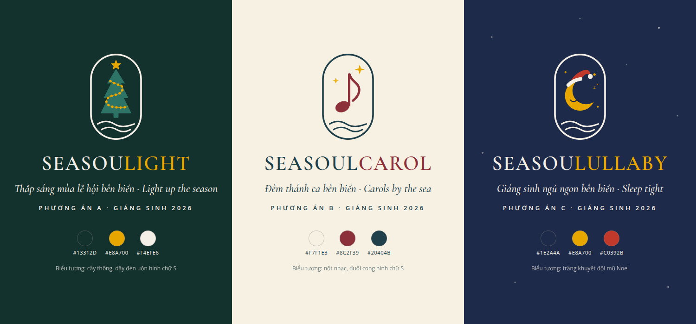
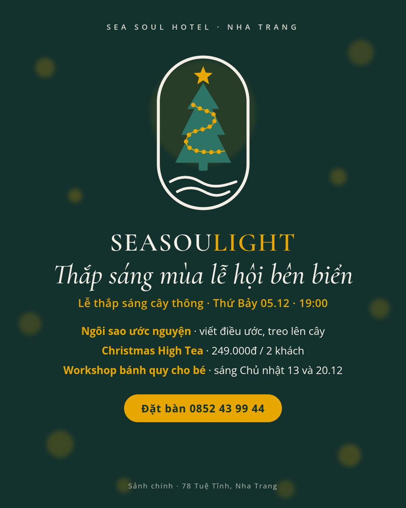
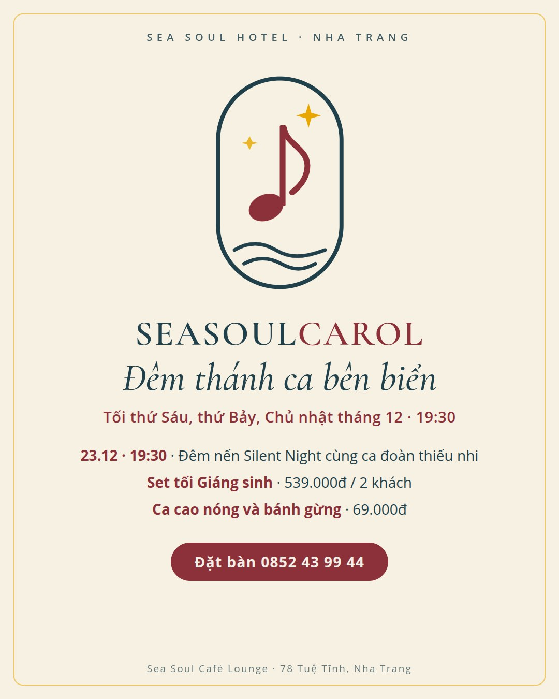
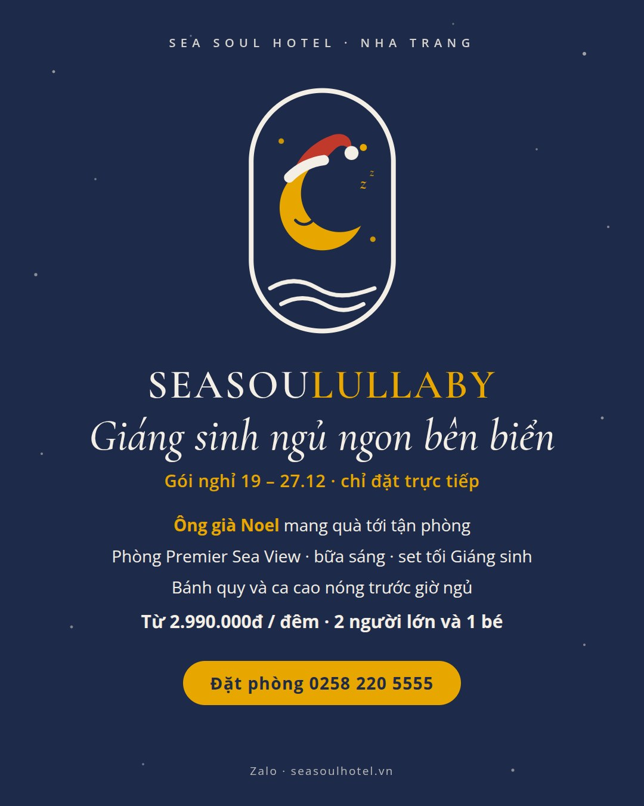

# Đề bài 2: Giáng sinh 2026, ba phương án

> - **Dữ liệu:** web và Fanpage Sea Soul, cào ngày 12/10/2026. Logo làm theo hệ thống ở [đề bài 1](1-20-10-halloween.md).
> - **Lịch:** 24/12 là thứ Năm, 25/12 là thứ Sáu. Ở Việt Nam đây là ngày đi học, đi làm bình thường. 01/01/2027 là thứ Sáu nên có kỳ nghỉ 3 ngày, 01 – 03/01. Tết Đinh Mùi rơi vào 06/02/2027.
> - **Thời gian chuẩn bị:** hôm nay 12/10, còn hơn 10 tuần. Lần này đủ thời gian để công bố trước 3–4 tuần.
> - **Mọi con số về giá, ngân sách và mục tiêu đều là đề xuất**, cần khách sạn duyệt.

## Tóm tắt

| | A. Seasoulight | B. Seasoulcarol | C. Seasoulullaby |
| --- | --- | --- | --- |
| Câu chủ đề | Thắp sáng mùa lễ hội bên biển | Đêm thánh ca bên biển | Giáng sinh ngủ ngon bên biển |
| Ý tưởng | Biến lễ thắp sáng cây thông thành truyền thống hằng năm | Nhạc sống cuối tuần tháng 12 thành đêm thánh ca, có một đêm nến cùng ca đoàn thiếu nhi | Gói nghỉ Giáng sinh, Ông già Noel mang quà tới tận phòng |
| Nghi thức | Treo ngôi sao ước nguyện lên cây | Chuyền ánh nến khi hát Silent Night | Ông già Noel gõ cửa phòng |
| Bán gì chính | Ăn uống, sự kiện | Ăn uống, sự kiện | Phòng |
| Khách chính | Gia đình và người trẻ ở Nha Trang | Cặp đôi, gia đình, khách nước ngoài | Gia đình có con nhỏ, khách quốc tế nghỉ lễ |
| Tiền mặt ước tính | Khoảng 18 triệu | Khoảng 20 triệu | Khoảng 13 triệu |
| Độ khó | Thấp, năm 2025 đã làm | Trung bình, cần ca đoàn | Trung bình, nhiều bộ phận cùng làm |

**Đề xuất:** chọn A làm chiến dịch chính và thêm gói phòng của C. Lý do ở mục 6.

## 1. Năm ngoái đã làm gì, năm nay có gì mới

**Giáng sinh 2025:**
- **Lễ thắp sáng cây thông ở sảnh chính, kèm mở thử Café Lounge:**
  - Diễn ra thứ Ba 23/12, 18:00 – 20:30. Buổi sáng có workshop trang trí bánh quy cho trẻ em.
  - Fanpage đăng từ 13/12, tức trước 10 ngày, được 137 lượt thích. Web đăng 16/12, chỉ trước 7 ngày, viết toàn bằng tiếng Anh, được 1.424 lượt xem.
  - Theo bài web, lễ thắp sáng có piano và dàn hợp xướng thiếu nhi.
- **Countdown kèm khai trương Café Lounge, ngày 31/12:**
  - Buffet hải sản nướng tặng nửa con tôm hùm: 799k người lớn, 399k trẻ em. Vé chỉ dự Countdown: 119k cho 2 người.
  - Fanpage đăng từ 17/12, tức trước 14 ngày. Web đăng 25/12, được 3.725 lượt xem, là bài sự kiện đông người xem nhất trên web.
- **Black Friday 28/11/2025 (chỉ trên Fanpage):** mua 1 tặng 1 phòng Suite, trọn gói 2.150.000đ, được 103 lượt thích.
- **Tiệc tất niên** từ 269k mỗi khách và **ưu đãi phòng** từ 495k mỗi khách mỗi đêm. Cả hai bài cùng đăng ngày 27/11.
- **Năm 2024:** web không có bài Giáng sinh nào.

**Năm 2026 có thêm:**
- **Café Lounge tròn 1 năm:** mở thử 23/12/2025, khai trương 31/12/2025.
- **Khách sạn vừa được làm mới:** hồ bơi nâng cấp xong sau 14/10, thảm hành lang thay xong 15/11.

## 2. Logo



- **Cùng hệ thống với đề bài 1:** khung bầu dục, sóng biển, một nét cong hình chữ S, font Cormorant Garamond.
- **Tên dễ hiểu hơn:** cả ba tên đều ghép với một từ tiếng Anh ai cũng biết: light, carol, lullaby. Đây là bài học từ cái tên Seasoulinance.
- **Tên Seasoulight:** dịp 8/3/2026, khách sạn đã dùng tên "SeaSoulighting Her Day". Đề xuất giữ tên Seasoulight và coi cả hai là cùng một "họ ánh sáng" xuyên suốt năm. Dùng lại một tên dễ hiểu cho nhiều dịp giúp khách dễ nhớ hơn là mỗi dịp một tên mới.
- **Tô màu cả từ gốc:**
  - Phần tô màu là nguyên từ tiếng Anh: SEASOU**LIGHT**, SEASOUL**CAROL**, SEASOU**LULLABY**. Nhờ vậy khách đọc là ra nghĩa ngay.
  - Nên áp dụng cách này cho cả các tên cũ, ví dụ SEASOU**LANTERN**.

## 3. Phương án A: Seasoulight, "Thắp sáng mùa lễ hội bên biển"

<p></p>

**Ý tưởng:**
- **Thắp sáng sớm.** Năm 2025, cây thông đến 23/12 mới được thắp sáng nên chỉ sáng vài ngày trước Giáng sinh. Năm nay làm vào thứ Bảy 05/12, để cây thành góc chụp ảnh suốt 3 tuần.
- **Thành truyền thống.** Lễ thắp sáng được làm vào cùng thời điểm mỗi năm.
- **Câu chuyện ánh sáng cả năm:** Trung thu có Seasoulantern với đèn lồng, Giáng sinh có Seasoulight với ánh đèn.

**Nghi thức: ngôi sao ước nguyện**
- Mỗi khách nhận một ngôi sao giấy, viết điều ước rồi treo lên cây.
- Tùy chọn: với mỗi ngôi sao, khách sạn góp 10.000đ vào một quỹ từ thiện ở Khánh Hòa, ví dụ quỹ cho trẻ em vùng lũ. Cần chọn đơn vị minh bạch và công bố số tiền sau chiến dịch.
- Tối 24/12 đọc vài điều ước, không nêu tên nếu khách không muốn.

**Sản phẩm và giá đề xuất:**

| Sản phẩm | Thời gian | Giá đề xuất | Ghi chú |
| --- | --- | --- | --- |
| Lễ thắp sáng cây thông | Thứ Bảy 05/12, 19:00 – 20:30, sảnh chính | Miễn phí | Hát mừng, Ông già Noel phát kẹo, đồ uống mùa lễ hội bán tại chỗ |
| Christmas High Tea | 05 – 27/12, 14:00 – 17:00 | 249k cho 2 khách | Bánh gừng, bánh khúc cây, trà quế |
| Workshop bánh quy cho bé | Sáng Chủ nhật 13/12 và 20/12 | 99k mỗi bé | Năm 2025 đã làm, nay giữ lại. Kèm khu lái xe tải công trường trang trí Giáng sinh: video khu này được 556 lượt thích |
| Bữa tối đêm Giáng sinh | Thứ Năm 24/12 | Buffet 699k người lớn, 349k trẻ em | Thấp hơn buffet Countdown 2025 (799k) |
| Sinh nhật 1 năm Café Lounge | Thứ Tư 23/12 | Giảm 20% đồ uống trong ngày, mời khách bánh kem | Giống ưu đãi 20% dịp kỷ niệm 2 năm khách sạn |
| Gói phòng | 19 – 27/12 | Xem phương án C | Đề xuất ghép thêm |

**Khách và mục tiêu:**
- **Khách:** gia đình và người trẻ ở Nha Trang, khách đang lưu trú.
- **Mục tiêu:** có thêm khách tới khách sạn trong tháng 12, tăng doanh thu ăn uống, tăng người theo dõi Fanpage.

**Ưu và nhược:**
- **Ưu:**
  - Dễ làm nhất, vì năm 2025 đã làm.
  - Nối tiếp được Seasoulantern.
  - Cây thông làm góc chụp ảnh suốt 3 tuần, nên dễ có ảnh khách tự đăng.
- **Nhược:**
  - Vẫn chủ yếu bán ăn uống, chưa giải quyết chuyện bán phòng.
  - Nhiều khách sạn khác cũng làm lễ thắp sáng cây thông.

## 4. Phương án B: Seasoulcarol, "Đêm thánh ca bên biển"

<p></p>

**Ý tưởng:**
- **Dựa vào thế mạnh có sẵn.** Nhạc sống là việc Sea Soul làm đều đặn nhất: từ tháng 2/2026 gần như tháng nào cũng có lịch nhạc.
- **Đổi lịch nhạc tháng 12.** Các tối thứ Sáu, thứ Bảy và Chủ nhật chuyển sang nhạc Giáng sinh, với violin, saxophone và ca sĩ.
- **Một đêm nến cùng ca đoàn thiếu nhi** ở Nha Trang, của nhà thiếu nhi hoặc của một giáo xứ. Ca đoàn thiếu nhi là chuyện báo địa phương dễ đưa tin. Lễ thắp sáng năm 2025 đã có dàn hợp xướng thiếu nhi, nên có thể mời lại.
- **Chọn ngày 23/12, không chọn 24/12.** Đêm 24/12, ca đoàn giáo xứ thường hát lễ ở nhà thờ. Ngày 23/12 lại trùng sinh nhật 1 năm của Café Lounge.

**Nghi thức: đêm nến Silent Night**
- 19:30 ngày 23/12, đèn tắt, mỗi khách cầm một cây nến điện.
- Khi ca đoàn hát Silent Night (Đêm thánh vô cùng), khách lần lượt chuyền ánh nến cho nhau.

**Sản phẩm và giá đề xuất:**

| Sản phẩm | Thời gian | Giá đề xuất | Ghi chú |
| --- | --- | --- | --- |
| Đêm thánh ca | Thứ Sáu, thứ Bảy, Chủ nhật tháng 12, 19:30 – 20:30 | Miễn phí khi gọi món | Thay cho lịch nhạc thường |
| Đêm nến Silent Night | Thứ Tư 23/12, 19:30 – 20:30 | Đặt chỗ trước, gọi món tối thiểu 300k mỗi khách | Ca đoàn thiếu nhi, nến điện |
| Set tối Giáng sinh | 18 – 27/12 | 539k cho 2 khách | Bằng giá set tối Valentine 2026 |
| Ca cao nóng và bánh gừng | Cả tháng 12 | 69k | Bán ở Café Lounge |

**Khách và mục tiêu:**
- **Khách:** cặp đôi, gia đình, giáo dân ở Nha Trang, khách nước ngoài.
- **Mục tiêu:** có một sự kiện riêng mà nơi khác khó sao chép, được báo địa phương đưa tin, tăng doanh thu ăn uống.

**Ưu và nhược:**
- **Ưu:**
  - Dùng nghệ sĩ có sẵn nên chi phí thấp.
  - Khác biệt với các khách sạn khác.
  - Gây xúc động, hợp quay video.
- **Nhược:**
  - Phụ thuộc chất lượng nghệ sĩ và ca đoàn.
  - Thánh ca là nhạc tôn giáo, nên giữ không khí trang trọng và không dùng hình ảnh tôn giáo để quảng cáo.

## 5. Phương án C: Seasoulullaby, "Giáng sinh ngủ ngon bên biển"

<p></p>

**Ý tưởng:**
- **Lấy Giáng sinh để bán phòng.** Phân tích trong [`tim-hieu/`](../tim-hieu/3-phan-tich.md) cho thấy phòng gần như vắng mặt trên web năm 2026. Trên Fanpage thì phần lớn bài về phòng chỉ là ảnh không có giá. Trong khi đó, những bài có ưu đãi cụ thể như Black Friday 2025 (mua 1 tặng 1 phòng Suite) hay gói hè Seasoulantics được thích gấp nhiều lần.
- **Chỉ bán qua kênh trực tiếp:** hotline, Zalo, web. Khách sạn không mất 15–20% hoa hồng cho OTA, và khách quen dần với việc đặt trực tiếp.
- **Có một thứ OTA không bán được:** Ông già Noel mang quà tới tận cửa phòng.

**Nghi thức: Ông già Noel gõ cửa**
- Lúc nhận phòng, bố mẹ gửi quà của bé ở lễ tân và ghi tên bé.
- Tối 24/12, hoặc tối đầu tiên của gói, từ 19:00 tới 20:30, Ông già Noel đi cùng một nhân viên tới gõ cửa từng phòng. Ông gọi tên bé và trao quà ngay ở cửa, có bố mẹ đứng cạnh. Chỉ chụp ảnh khi gia đình đồng ý.
- Trong phòng có một cây thông nhỏ. Trước giờ ngủ, gia đình được mang tới bánh quy và ca cao nóng.

**Sản phẩm và giá đề xuất:**

| Sản phẩm | Thời gian | Giá đề xuất | Gồm |
| --- | --- | --- | --- |
| Gói Seasoulullaby | Nhận phòng từ 19 tới 27/12 | Từ 2.990.000đ mỗi đêm cho 2 người lớn và 1 bé dưới 12 tuổi | Phòng Premier Sea View, bữa sáng, set tối Giáng sinh, Ông già Noel, bánh quy và ca cao, trả phòng muộn lúc 14:00 |
| Ưu đãi đặt sớm | Đặt trước 30/11 | Tặng 30 phút spa | |
| Gói Năm mới | 31/12 – 03/01 | Tính riêng | Cho kỳ nghỉ 3 ngày đầu năm, kèm vé Countdown |

Giá gói cần tính lại theo giá phòng Premier Sea View tháng 12 mà khách sạn đang bán.

**Khách và mục tiêu:**
- **Khách:**
  - Gia đình có con nhỏ ở Khánh Hòa và các tỉnh lân cận. Nhóm này đi chủ yếu vào hai cuối tuần 19–20/12 và 26–27/12, vì 24 và 25/12 các bé vẫn đi học.
  - Khách quốc tế nghỉ lễ Giáng sinh, ví dụ khách Hàn Quốc, Úc, châu Âu.
- **Mục tiêu:** số đêm phòng bán trực tiếp, tỷ lệ khách đặt trực tiếp, điểm đánh giá sau kỳ nghỉ.

**Ưu và nhược:**
- **Ưu:**
  - Đánh đúng điểm yếu lớn nhất là bán phòng.
  - Doanh thu mỗi lượt đặt cao.
  - Khoảnh khắc trẻ em nhận quà dễ lan truyền, và khách dễ để lại đánh giá tốt.
- **Nhược:**
  - Lễ tân, buồng phòng và bếp phải phối hợp chặt.
  - Mỗi tối chỉ làm được khoảng 20 phòng, để Ông già Noel kịp đi hết trong 90 phút.

## 6. So sánh và đề xuất

| Tiêu chí | A. Seasoulight | B. Seasoulcarol | C. Seasoulullaby |
| --- | --- | --- | --- |
| Doanh thu chính | Ăn uống | Ăn uống | Phòng |
| Mức khác biệt | Trung bình | Cao | Cao |
| Độ khó | Thấp | Trung bình | Trung bình |
| Rủi ro chính | Giống khách sạn khác | Phụ thuộc ca đoàn | Nhiều bộ phận phải phối hợp |
| Sửa được điểm yếu nào trong phân tích | Báo sớm, có nghi thức riêng | Báo sớm, có sự kiện riêng | Đưa phòng trở lại, tăng đặt trực tiếp |

**Đề xuất: chọn A làm chiến dịch chính và thêm gói phòng của C.** Tổng tiền mặt khoảng 23 triệu.
- **A là nền:** dễ làm nhất, nối tiếp Seasoulantern thành một câu chuyện ánh sáng, và kéo dài được 3 tuần.
- **Gói phòng của C bù chỗ A còn thiếu:** bán phòng và bán trực tiếp. Chi thêm khoảng 5 triệu.
- **Nếu có ca đoàn sẵn lòng,** lấy đêm nến 23/12 của B làm một sự kiện trong A. Ánh nến vẫn hợp với chủ đề ánh sáng.

**Bổ sung sau khi xem 153 bài Fanpage cũ** (lý do ở [`3-bai-hoc-va-dieu-chinh.md`](3-bai-hoc-va-dieu-chinh.md)):
- **Tiệc Giáng sinh và tất niên cho doanh nghiệp, mở bán từ 01/11.** Giá khoảng 280k mỗi khách như tháng 01/2026, đặt trước 30/11 có ưu đãi. Đây là nhóm bài được thích nhiều nhất trên Fanpage; tiệc tất niên 2025 được 1.066 lượt thích.
- **Black Friday 27/11: lặp lại "mua 1 tặng 1 phòng Suite"** như năm 2025 (103 lượt thích), áp dụng cho kỳ nghỉ Giáng sinh và kèm quà của Ông già Noel.
- **Bỏ bài lời chúc Giáng sinh.** Năm 2025, video lời chúc chỉ được 11 lượt thích. Thay bằng bài nhắc giờ và giá của bữa tối đêm 24/12.
- **Mời lại dàn hợp xướng thiếu nhi** đã hát ở lễ thắp sáng năm 2025.
- **Đăng bài chính lúc 19:00 – 21:00, giá ở dòng đầu.**

## 7. Lịch triển khai cho phương án đề xuất

| Khi nào | Việc |
| --- | --- |
| Trước 31/10 | Chọn phương án, duyệt ngân sách và giá |
| 01/11 | Mở bán tiệc Giáng sinh và tất niên cho doanh nghiệp, ưu đãi đặt trước 30/11 |
| 01 – 15/11 | Đặt đồ trang trí, in ngôi sao. Cài gói phòng vào hệ thống đặt phòng. Chọn quỹ từ thiện |
| Sau 15/11 | Chụp ảnh khách sạn vừa làm mới: hành lang, hồ bơi, phòng Premier Sea View |
| T2 16/11 | Mở bán gói Seasoulullaby, ưu đãi đặt trước 30/11 |
| T6 20/11 | Công bố lễ thắp sáng ngày 05/12 |
| T6 27/11 | Black Friday: mua 1 tặng 1 phòng Suite cho kỳ nghỉ Giáng sinh, như năm 2025 |
| T7 05/12 | Lễ thắp sáng. Livestream, đăng reel trong vòng 24 giờ |
| Trước 10/12 | Công bố Countdown 2027. Năm ngoái Fanpage đăng 17/12, web tới 25/12 mới đăng |
| CN 13/12 và 20/12 | Workshop bánh quy |
| T4 23/12 | Sinh nhật 1 năm Café Lounge |
| T5 24/12 | Bữa tối đêm Giáng sinh. Ông già Noel đi phòng |
| 26 – 27/12 | Reel tổng kết, bài tổng kết trên web |

Tiệc tất niên cần một người phụ trách và ngân sách riêng, nhưng mở bán cùng lúc với tiệc Giáng sinh từ 01/11. Tết rơi vào 06/02/2027 nên tiệc tất niên sẽ dồn vào tháng 1, và doanh nghiệp chốt chỗ từ tháng 11 – 12.

## 8. Nội dung mẫu

**Bài công bố phương án A**

```text
SEASOULIGHT – Thắp sáng mùa lễ hội bên biển ✨

Tối thứ Bảy 05/12, mời bạn cùng Sea Soul thắp sáng cây thông Giáng sinh ở sảnh chính.

✦ Lễ thắp sáng cây thông – 19:00 – 20:30, miễn phí
Ông già Noel phát kẹo cho bé, hát mừng Giáng sinh, đồ uống mùa lễ hội.

✦ Ngôi sao ước nguyện
Viết điều ước lên một ngôi sao và treo lên cây. Mỗi ngôi sao, Sea Soul góp 10.000đ cho [tên quỹ].

✦ Christmas High Tea – 249.000đ / 2 khách
05 – 27/12, 14:00 – 17:00.

✦ Workshop bánh quy cho bé – sáng Chủ nhật 13 và 20/12

Đặt bàn: 0852 43 99 44
📍 78 Tuệ Tĩnh, Nha Trang

Light up the season with us: Christmas tree lighting at Sea Soul Hotel, Saturday 5 Dec, 7 PM.

#Seasoulight #SeaSoulHotel #GiangSinhNhaTrang #NhaTrang
```

**Bài bán gói phòng của phương án C**

```text
SEASOULULLABY – Giáng sinh ngủ ngon bên biển 🌙

Đêm Giáng sinh này, Ông già Noel sẽ gõ cửa phòng của bé.

Gói nghỉ nhận phòng 19 – 27/12, từ 2.990.000đ mỗi đêm cho 2 người lớn và 1 bé:
✦ Phòng Premier Sea View và bữa sáng
✦ Set tối Giáng sinh cho 2 người lớn
✦ Ông già Noel mang quà tới tận cửa phòng
✦ Bánh quy và ca cao nóng trước giờ ngủ
✦ Trả phòng muộn lúc 14:00

Đặt trước 30/11: tặng 30 phút spa.
Gói chỉ bán khi đặt trực tiếp: 0258 220 5555, Zalo hoặc seasoulhotel.vn

#Seasoulullaby #SeaSoulHotel #NhaTrang
```

**Kịch bản reel lễ thắp sáng (15–20 giây)**

| Giây | Hình | Chữ trên hình |
| --- | --- | --- |
| 0–3 | Sảnh tối, bàn tay một em bé đặt lên nút bấm | 3… 2… 1… |
| 3–7 | Cây thông bừng sáng, cả sảnh vỗ tay | SEASOULIGHT |
| 7–12 | Khách treo ngôi sao ước nguyện, cận nét chữ viết tay | Điều ước của bạn là gì? |
| 12–16 | Ông già Noel phát kẹo, các bé cười | |
| Cuối | Logo chiến dịch | High Tea 249k · Đặt bàn 0852 43 99 44 |

**Kịch bản reel gói phòng (15 giây):** Ông già Noel đi dọc hành lang vừa thay thảm mới, gõ cửa. Cửa mở, em bé reo lên. Cảnh cuối là cây thông nhỏ trong phòng, phía sau cửa kính là biển. Chỉ quay khi bố mẹ đồng ý.

## 9. Đo kết quả

| Chỉ số | Cách đo | Mục tiêu đề xuất |
| --- | --- | --- |
| Số khách dự lễ thắp sáng | Đếm số ngôi sao phát ra | 150 khách |
| Doanh thu ăn uống tháng 12 | Hệ thống bán hàng | Cao hơn tháng 12/2025 |
| Người theo dõi Fanpage | Meta Business Suite | Thêm 500 người trong tháng 12 |
| Số gói Seasoulullaby bán được | Hệ thống đặt phòng | 40 đêm phòng |
| Tỷ lệ đặt trực tiếp trong tuần Giáng sinh | So với cùng kỳ 2025 | Cao hơn năm 2025 |
| Lượt xem reel lễ thắp sáng | Meta Business Suite | Từ 33 nghìn, ngang reels buffet hè |

## 10. Rủi ro và cách xử lý

- **Mưa:** mọi hoạt động làm trong nhà.
- **Ông già Noel và trẻ em:** chọn người phù hợp, luôn có nhân viên đi cùng, chỉ trao quà ở cửa phòng khi bố mẹ có mặt, không vào trong phòng.
- **Ảnh trẻ em:** chỉ đăng khi bố mẹ đồng ý.
- **Quỹ từ thiện:** chọn đơn vị minh bạch, công bố số tiền đã góp sau chiến dịch.
- **Trùng việc:** tất niên, Giáng sinh và Countdown cùng rơi vào tháng 11 – 12. Mỗi việc cần một người chịu trách nhiệm và một lịch đăng riêng.

## 11. Cần khách sạn xác nhận

- Cây thông và đồ trang trí năm 2025 còn dùng lại được không.
- Giá phòng Premier Sea View tháng 12, để tính giá gói.
- Có người đóng vai Ông già Noel và có nhân viên đi cùng vào tối 24/12 không.
- Tỷ lệ khách quốc tế trong tuần Giáng sinh năm 2025, chia theo nước.
- Có ca đoàn nào sẵn lòng tham gia không, nếu chọn thêm đêm nến của B.
- Quỹ từ thiện muốn hợp tác.
