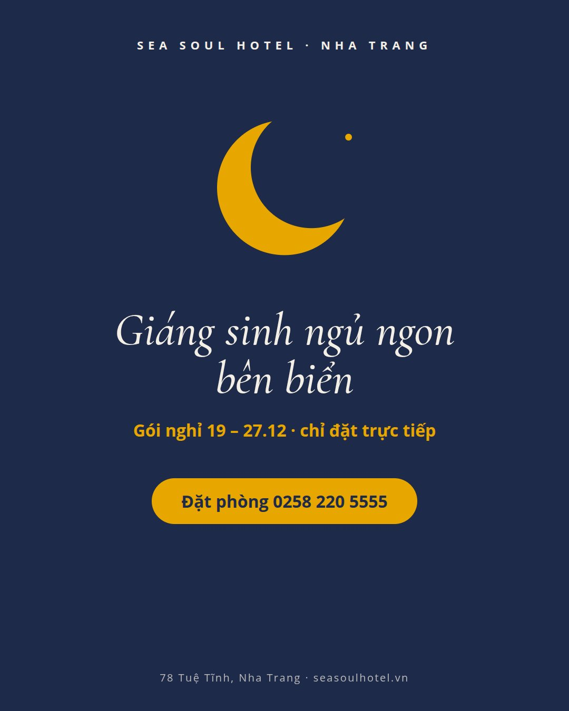
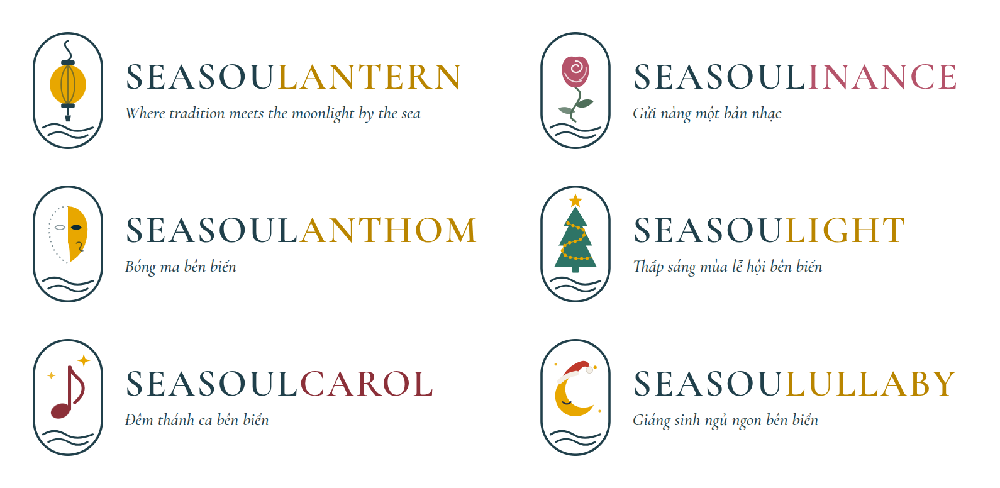

# Cách làm hình và file PDF

Hình trong [`../hinh/`](../hinh/) không vẽ tay và không dùng AI tạo ảnh. Mỗi hình là một đoạn code mô tả hình khối, chữ và màu. Trình duyệt Chrome vẽ đoạn code đó ra, rồi chụp lại thành ảnh. File PDF báo cáo cũng làm cùng cách: Chrome in một trang web ra PDF.

**Trong thư mục này:**

| File | Là gì |
| --- | --- |
| [`vi-du-don-gian.html`](vi-du-don-gian.html) | Ví dụ ngắn, có chú thích từng phần. Mở bằng Chrome để xem và sửa thử |
| `vi-du-don-gian.jpg` | Ảnh xuất ra từ ví dụ trên |
| `logo/*.svg` | 6 biểu tượng chiến dịch dạng SVG, đưa vào Canva được |
| `logo/*.png` | 6 logo đầy đủ gồm biểu tượng và tên, nền trong suốt |
| `logo/tong-hop.png` | Ảnh xem nhanh cả 6 logo |

<p></p>



## 1. Quy trình 5 bước

1. **Lấy bộ nhận diện của Sea Soul:** font, màu, kiểu logo.
2. **Vẽ logo bằng SVG.**
3. **Dựng bài đăng bằng HTML và CSS,** như một trang web có kích thước cố định.
4. **Mở bằng Chrome và chụp từng khung** đúng kích thước.
5. **Xem lại ảnh, thấy lỗi thì sửa code rồi chụp lại.**

## 2. Lấy bộ nhận diện từ web Sea Soul

Tôi tải 3 file từ seasoulhotel.vn: file logo, `fonts.css` và `custom.css`. Mỗi lần tải cách nhau 15–20 giây. Các file này lưu ngoài repo, ở `../sea_soul/crawl-2026-10/brand/`.

| Thứ | Lấy ở đâu | Giá trị |
| --- | --- | --- |
| Font tiêu đề | `fonts.css` | Cormorant Garamond |
| Font chữ thường | `fonts.css` | Open Sans |
| Màu chính | File logo | Xanh #20404B |
| Màu nhấn | Trang chủ | Vàng #E8A700 |
| Hình khối | Logo | Khung bầu dục, cây dừa có thân hình chữ S, hai đường sóng |

Cả hai font đều miễn phí trên Google Fonts và có sẵn trong Canva.

**Màu riêng của từng dịp** (do tôi chọn):

| Chiến dịch | Màu |
| --- | --- |
| Seasoulinance (20/10) | Hồng đất #B5536A, nền hồng phấn #F6E9E6 |
| Seasoulanthom (Halloween) | Nền xanh đêm #0F2A33, nhấn vàng #E8A700, thêm chút cam #E07A2E |
| Seasoulight (Giáng sinh A) | Nền xanh thông #13312D, cây #2E7466, đèn vàng #E8A700 |
| Seasoulcarol (Giáng sinh B) | Nền kem #F7F1E3, đỏ rượu vang #8C2F39 |
| Seasoulullaby (Giáng sinh C) | Nền xanh đêm #1E2A4A, trăng vàng #E8A700, mũ đỏ #C0392B |
| Seasoulful Tết (Tết 2027) | Nền đỏ #8E1F24, hoa mai vàng #E8A700, cành màu be #E6D2B5 |
| Chữ trên nền tối | Trắng ngà #F4EFE6 |

Logo thật của Sea Soul chỉ dùng để xem kiểu dáng. Tôi không chép logo đó vào hình và không đưa nó vào repo.

## 3. Vẽ logo bằng SVG

**SVG là gì?** Là ảnh được mô tả bằng chữ: vẽ hình gì, ở đâu, to bao nhiêu, màu gì. Phóng to bao nhiêu cũng không bị vỡ. Mở một file `.svg` trong `logo/` bằng Notepad là thấy ngay đoạn code.

**Khung vẽ:** `viewBox="0 0 100 160"`, tức rộng 100 và cao 160 đơn vị. Góc trên bên trái là điểm (0, 0). Trục x tăng sang phải, trục y tăng xuống dưới.

**Các lệnh đã dùng:**

| Lệnh | Vẽ gì | Dùng ở đâu trong logo |
| --- | --- | --- |
| `<rect rx="45">` | Hình chữ nhật bo góc. Bo bằng nửa chiều ngang thì thành hình bầu dục | Khung |
| `<circle>` | Hình tròn, có tâm (cx, cy) và bán kính r | Mặt trăng, bóng đèn, ngôi sao nhỏ |
| `<ellipse>` | Hình elip | Thân đèn lồng, đầu nốt nhạc |
| `<path d="...">` | Đường hoặc hình bất kỳ | Sóng, bông hồng, mặt nạ, cây thông |
| `fill`, `stroke` | Màu tô bên trong, màu nét viền | Mọi hình |

**Cách đọc một đường `path`:**
- `M`: đặt bút xuống.
- `L`: kẻ thẳng.
- `C`: vẽ đường cong, gồm 2 điểm kéo cong và 1 điểm đến.
- `S`: vẽ tiếp một đường cong mềm.
- `A`: vẽ cung tròn.
- `Z`: khép kín hình.

Ví dụ đường sóng `M17 129 C27 123 37 123 47 129 S67 135 83 129`: đặt bút ở (17, 129), cong lên rồi xuống tới (47, 129), sau đó cong xuống rồi lên tới (83, 129).

**Từng biểu tượng:**
- **Khung và sóng:** 1 hình bầu dục và 2 đường sóng, giống logo Sea Soul để nhìn là biết của khách sạn.
- **Nét chữ S:** biểu tượng nào cũng có một nét cong hình chữ S, như thân cây dừa trong logo chính. Đó là thân bông hồng, dây đèn trên cây thông, đuôi nốt nhạc, dây treo đèn lồng.
- **Bông hồng:** 1 hình bông màu hồng đất, 3 nét trắng làm cánh hoa, thân chữ S và 2 chiếc lá.
- **Mặt nạ:** nửa mặt tô vàng. Nửa còn lại chỉ là đường chấm. Mắt là một hình hạt màu tối.
- **Cây thông:** 1 ngôi sao 5 cánh, 3 tầng lá và dây đèn chữ S. Trên dây đèn có 15 bóng đèn cách đều nhau; vị trí từng bóng do trình duyệt tính.
- **Cành mai (Tết 2027):** cành uốn hình chữ S, 2 nụ và 3 bông mai. Mỗi bông là 5 hình tròn xếp quanh một tâm, cách nhau 72 độ.
- **Trăng khuyết** có hai cách vẽ:

```html
<!-- Cách 1, dùng trong bài đăng: 2 hình tròn. Hình thứ hai có màu nền, đè lên để "khoét" hình vàng -->
<circle cx="50" cy="78" r="27" fill="#E8A700"/>
<circle cx="61" cy="69" r="24.5" fill="#1E2A4A"/>

<!-- Cách 2, dùng trong file logo rời: một hình gồm 2 cung tròn, đặt trên nền màu nào cũng đúng -->
<path d="M43.57 51.76 A27 27 0 1 0 74.43 89.5 A24.5 24.5 0 0 1 43.57 51.76 Z" fill="#E8A700"/>
```

Hai điểm (43.57, 51.76) và (74.43, 89.5) là chỗ hai hình tròn cắt nhau, tính bằng công thức hình học.

**Dùng lại một biểu tượng nhiều lần:**
- Trong file thiết kế, mỗi biểu tượng chỉ viết một lần trong thẻ `<symbol>`, rồi gọi lại bằng `<use>`.
- Màu đổi bằng biến, ví dụ `--accent` (màu nhấn) và `--bg` (màu nền). Nhờ vậy một biểu tượng dùng được cả trên nền sáng lẫn nền tối.

**File logo rời trong `logo/`** được viết lại cho dễ dùng ở chỗ khác. Không có `<use>`, không có biến màu, và nét đứt được thay bằng các chấm tròn thật, để Canva đọc đúng.

## 4. Dựng bài đăng bằng HTML và CSS

**Mỗi hình là một khung có kích thước cố định:**

| Hình | Kích thước (điểm ảnh) | Dùng cho |
| --- | --- | --- |
| Bài đăng | 1080 × 1350 | Facebook, Instagram (tỷ lệ 4:5) |
| Ảnh bìa reel | 1080 × 1920 | Reels, TikTok, Story (tỷ lệ 9:16) |
| Voucher | 1200 × 560 | In, gửi doanh nghiệp |
| Bảng logo | 1500 × 700 | Trình bày hệ thống logo |

**Bố cục:**
- Các phần xếp thành một cột từ trên xuống và căn giữa: tên khách sạn, biểu tượng, tên chiến dịch, câu chủ đề, ngày giờ, 3 dòng ưu đãi, nút đặt bàn, địa chỉ.
- Code CSS cho việc này: `display: flex; flex-direction: column; align-items: center;`.

**Chữ:**
- Tiêu đề dùng Cormorant Garamond nghiêng.
- Chữ thường dùng Open Sans.
- Dòng tên khách sạn được giãn chữ bằng `letter-spacing`.
- Số dùng kiểu hiện đại bằng `font-variant-numeric: lining-nums`.

**Cảnh minh họa:**
- **Bầu trời:** dải màu chuyển từ hồng đậm xuống hồng nhạt (`linearGradient`).
- **Biển:** một hình chữ nhật màu xanh chuyển đậm dần, thêm vài đường sóng nhạt.
- **Trăng:** một hình tròn, có thêm một vầng sáng mờ quanh nó.
- **Nến:** thân nến là hình chữ nhật, ngọn lửa là hình giọt nước, quầng sáng là hình tròn mờ dần ra ngoài (`radialGradient`).
- **Đốm sáng ở nền:** các hình tròn được làm nhòe (`feGaussianBlur`).

**Vùng an toàn của ảnh bìa reel:** chữ chính đặt ở giữa khung. Khoảng 1/3 phía dưới để trống, vì ứng dụng hiện nút bấm và chú thích ở đó.

## 5. Chụp thành ảnh

**Bước 1. Chạy một máy chủ tạm,** chỉ máy mình truy cập được:

```bash
cd de-xuat/nguon
python3 -m http.server 8765 --bind 127.0.0.1
```

**Bước 2. Dùng Playwright để điều khiển Chrome tự động.** Đây là đoạn code tôi đã chạy:

```js
async (page) => {
  await page.setViewportSize({ width: 1600, height: 1000 });
  await page.goto('http://127.0.0.1:8765/mau-thiet-ke.html', { waitUntil: 'networkidle' });
  await page.evaluate(() => document.fonts.ready);       // chờ tải xong font
  await page.locator('#post2010').screenshot({           // chụp đúng khung bài đăng 20/10
    path: 'bai-20-10.jpg', type: 'jpeg', quality: 88,
  });
}
```

**Định dạng ảnh:**
- Logo chụp ra PNG để nét sắc. Muốn nền trong suốt thì thêm `omitBackground: true`.
- Bài đăng chụp ra JPG chất lượng 88, mỗi ảnh khoảng 100 KB.

**Khung nào ra ảnh nào:**

| File thiết kế | Mã khung | Ảnh xuất ra |
| --- | --- | --- |
| `mau-thiet-ke.html` | `logos` | `logo-he-thong.png` |
| `mau-thiet-ke.html` | `post2010`, `reel2010` | `bai-20-10.jpg`, `reel-20-10.jpg` |
| `mau-thiet-ke.html` | `postHw`, `reelHw` | `bai-halloween.jpg`, `reel-halloween.jpg` |
| `mau-thiet-ke.html` | `voucher` | `voucher-20-10.jpg` |
| `mau-giang-sinh.html` | `xlogos` | `logo-giang-sinh.png` |
| `mau-giang-sinh.html` | `xA`, `xB`, `xC` | `giang-sinh-a.jpg`, `giang-sinh-b.jpg`, `giang-sinh-c.jpg` |
| `mau-tet-2027.html` | `tet` | `tet-2027.jpg` |

Bản không có số điện thoại trong `../hinh/khong-sdt/`: chụp lại các khung `post2010`, `postHw`, `xA`, `xC`, `tet` sau khi thêm class `no-tel` vào thẻ `<html>`. Số điện thoại trên nút nằm trong `<span class="tel">`, và CSS `.no-tel .tel { display: none; }` ẩn phần này. Chụp bình thường thì hình vẫn có số.

## 6. Xem lại và sửa

Tôi xem từng ảnh vừa chụp, thấy lỗi thì sửa code rồi chụp lại:

| Lỗi | Vì sao | Cách sửa |
| --- | --- | --- |
| Ngày "20.10" trông như "2o.1o" | Cormorant Garamond mặc định dùng kiểu số cổ | Thêm `font-variant-numeric: lining-nums` |
| Phần dưới bài đăng trống nhiều | Các phần dồn hết lên trên | Phóng to biểu tượng, tăng khoảng cách, thêm dòng địa chỉ ở cuối |
| Cảnh mặt trời lặn trên biển | Nha Trang nhìn ra biển ở phía đông, nên không có cảnh này | Đổi thành trăng lúc chập tối. Ngày 20/10 là khoảng mùng 10 âm lịch, trăng đã hơn nửa |
| Câu chủ đề trong bảng logo bị xuống 2 dòng | Câu quá dài | Rút gọn câu |
| Bảng tổng hợp logo bị cắt lệch | Chụp nhiều logo trên cùng một trang | Chụp mỗi logo trên một trang riêng |
| Ngôi sao dính vào mũi trăng trong file ví dụ | Đặt sai tọa độ | Dời ngôi sao lên góc trên |

## 7. File PDF báo cáo

**Báo cáo là một trang web khổ A4:** [`bao-cao/nguon/bao-cao-mua-le-hoi-2026.html`](../../bao-cao/nguon/bao-cao-mua-le-hoi-2026.html).
- Khổ giấy và lề: `@page { size: A4; margin: 15mm 15mm 16mm 15mm; }`. Riêng trang bìa không có lề: `@page cover { margin: 0; }`.
- Số trang nằm sẵn trong CSS, ở ô chân trang của `@page`: `@bottom-right { content: "Trang " counter(page) " / " counter(pages); }`. Trang bìa tắt ô này bằng `content: none`.
- Mỗi phần bắt đầu ở một trang mới: `section { break-before: page; }`.
- Một dòng của bảng, hay khối nội dung của một dịp, không bị cắt ngang giữa hai trang: `break-inside: avoid`.

**Xuất bằng Chrome.** Lệnh in PDF của Chrome, tương đương bấm Ctrl+P rồi lưu thành PDF:

```js
await send('Page.printToPDF', { printBackground: true, preferCSSPageSize: true, displayHeaderFooter: false });
```

Bản cũ in số trang bằng chân trang của Chrome, nên phải xuất 2 bản rồi ghép để bỏ số trang ở bìa. Từ khi số trang nằm trong CSS, không cần ghép nữa.

**Kiểm tra bằng bộ công cụ poppler:**
- `pdfinfo`: số trang, khổ giấy.
- `pdftotext`: chữ tiếng Việt có hiện đúng không.
- `pdftoppm`: xuất ảnh từng trang để xem bố cục.
- `pdftotext -bbox`: tìm chữ nằm sai chỗ.

**Hai lỗi đã gặp ở bản PDF:**
- Số trang hiện cả trên bìa. Nay sửa bằng `@page cover`, như trên.
- Có chấm lạ ở cuối mỗi trang. Nguyên nhân là dấu của chữ in hoa có hai dấu (Ầ, Ữ, Ệ) ở đầu trang sau bị in tràn ngược lên trang trước. Sửa bằng cách tăng chiều cao dòng của nhãn "PHẦN …".

## 8. Tự sửa hoặc tự làm

**Cách A: sửa mẫu có sẵn, không cần cài thêm gì**
1. Mở file trong [`../nguon/`](../nguon/) bằng Notepad hoặc VS Code. Tìm đoạn chữ cần đổi (Ctrl+F), sửa rồi lưu.
2. Kéo file đó vào Chrome. Máy cần có mạng để tải font.
3. Bấm F12, vào tab Elements, tìm khung cần chụp (ví dụ `<div id="post2010">`). Nhấp chuột phải vào khung đó và chọn "Capture node screenshot". Chrome sẽ lưu một ảnh PNG đúng bằng khung. Nếu màn hình đang để tỷ lệ 125% hay 150%, ảnh sẽ lớn hơn theo tỷ lệ đó; đăng Facebook vẫn được.
4. Muốn xuất lại PDF: mở `bao-cao/nguon/bao-cao-mua-le-hoi-2026.html` bằng Chrome, bấm Ctrl+P, chọn "Lưu dưới dạng PDF", khổ A4, bật "Đồ họa nền", tắt "Đầu trang và chân trang". Số trang vẫn có, vì đã nằm sẵn trong CSS.

**Cách B: làm trên Canva, khi đã có ảnh chụp thật**
1. Tạo thiết kế 1080 × 1350 cho bài đăng, hoặc 1080 × 1920 cho reel.
2. Tải file biểu tượng `.svg` trong `logo/` lên Canva. Canva cho đổi màu từng phần của SVG, ví dụ đổi khung sang trắng ngà #F4EFE6 khi đặt trên nền tối.
3. Gõ tên chiến dịch bằng font Cormorant Garamond và chữ thường bằng Open Sans, cả hai đều có sẵn trong Canva. Hoặc dùng luôn file `.png` đã có sẵn tên chiến dịch.
4. Dùng các mã màu ở mục 2.
5. Sắp các phần theo thứ tự ở mục 4.

**Cách C: nhờ tôi**
- Cho tôi biết cần đổi gì: chữ, giá, ngày hay màu. Tôi sửa file và xuất lại.

## 9. Giới hạn

- **Không tạo được ảnh chụp thật.** Cảnh biển, trăng, nến trong mẫu đều là hình minh họa.
- **Chỉ làm được hình phẳng kiểu đồ họa.** Bản đăng thật nên dùng ảnh chụp tại khách sạn.
- **Logo thật của Sea Soul không có trong repo.** Khi làm thật thì ghép logo chính vào.
